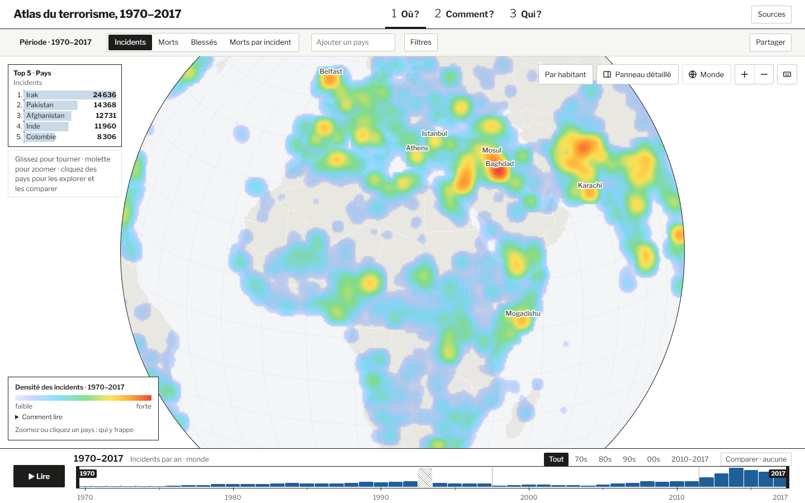
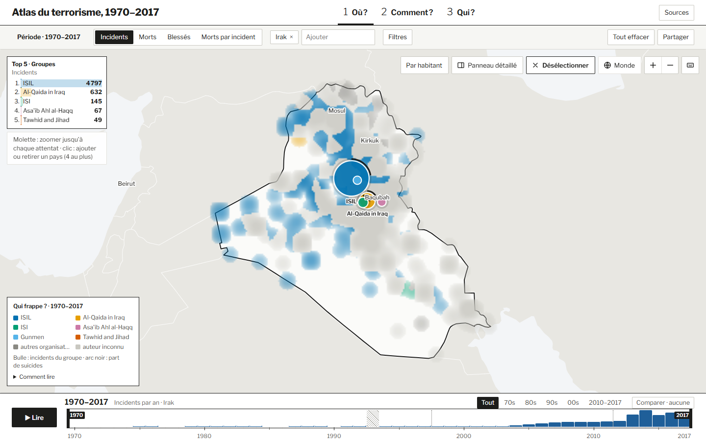
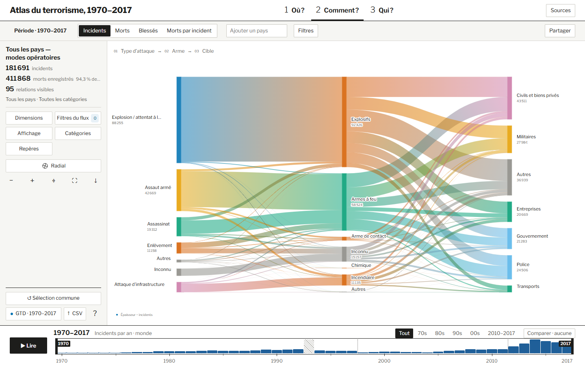
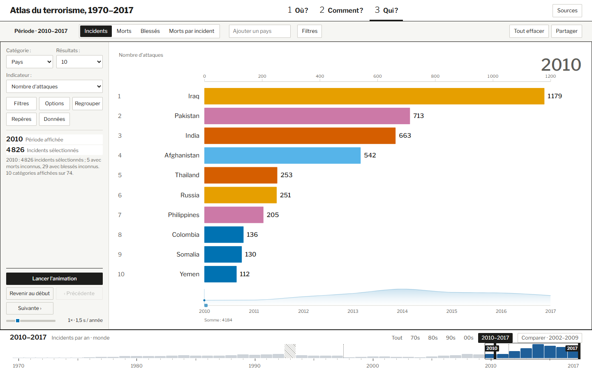

# Atlas du terrorisme, 1970–2017

Rapport de conception en visualisation de l’information

## Résumé

L’Atlas du terrorisme permet d’explorer 181 691 attentats recensés par la Global Terrorism Database entre 1970 et 2017. Le projet répond à trois questions complémentaires. Où les incidents se concentrent-ils ? Quels types d’attaque, d’arme et de cible sont associés ? Quels pays ou groupes occupent les premiers rangs, et comment cet ordre évolue-t-il ? L’application s’adresse aux journalistes de données, aux étudiants et chercheurs, aux analystes d’ONG et d’institutions, ainsi qu’au public curieux. Leurs besoins vont d’un chiffre rapidement vérifiable à l’exploration prolongée d’un territoire ou d’une organisation.

La planche **Où ?** donne une vue d’ensemble avec une carte de chaleur. Au zoom, elle privilégie les groupes localement dominants, puis les attentats individuels lorsque les symboles peuvent être distingués. Le lecteur peut rapprocher la carte d’une frise, de chiffres comparatifs ou d’un classement compact. **Comment ?** utilise un diagramme de Sankey pour relier des catégories et faire ressortir les associations fréquentes. **Qui ?** place les catégories sur une échelle commune de barres horizontales. L’animation rend les changements de rang visibles et la pause permet de vérifier une valeur. Les trois planches partagent un contexte de période, de mesure et de sélection de pays pour qu’un lecteur puisse approfondir une question en changeant de représentation.

Les données passent de l’incident enregistré à plusieurs niveaux de regroupement, selon la question posée. La densité s’appuie sur les événements géolocalisés, tandis que les totaux peuvent inclure des incidents sans coordonnées. Les moyennes utilisent les bilans connus et l’absence de données en 1993 est distinguée d’une valeur nulle. Le rapport relie les choix graphiques et interactifs à des tâches concrètes, à partir du cadre **What–Why–How**.

## 1. Publics, objectifs, scénarios et tâches

| ID | Persona | Contexte et niveau | Objectif |
| --- | --- | --- | --- |
| U1 | Journalistes de données | Préparent un article sur une région. À l’aise avec les données, peu de temps. | Repérer une tendance, vérifier un chiffre, trouver un incident à citer et partager le contexte. |
| U2 | Étudiants et chercheurs | Étudient un conflit, un groupe ou une période. Usage approfondi et exploratoire. | Comparer des périodes et des modes opératoires, croiser des filtres et examiner des cas précis. |
| U3 | Analystes d’ONG et d’institutions | Étudient une zone d’intervention. Connaissance du terrain, besoin de synthèse. | Identifier les zones et les cibles les plus touchées et situer leur évolution dans la période couverte. |
| U4 | Public curieux | Découvre le sujet, notamment en contexte éducatif. Novice. | Comprendre la répartition globale, puis approfondir un exemple sans formation préalable. |

### Scénarios

Ces parcours sont proposés pour la démonstration. Le résultat attendu indique ce qu’on peut vérifier auprès d’un lecteur.

| Scénario | Parcours | Résultat attendu | Tâches |
| --- | --- | --- | --- |
| S1 · U1 prépare un article sur les pays les plus touchés entre 2013 et 2017. | Dans **Où ?**, choisir 2013–2017 et **Morts**, lire le top 5, puis sélectionner un pays. Comparer son bilan à 2008–2012 et ouvrir une fiche d’incident. | Citer une valeur avec son unité et sa période, décrire son évolution et retrouver un cas précis. | T1, T4, T9, T10 |
| S2 · U2 étudie les groupes et les modes opératoires au Nigeria. | Repérer des concentrations dans **Où ?**, puis examiner les groupes et leurs mini-frises. Dans **Comment ?**, comparer les attaques suicides et non suicides à pays et période constants. Dans **Qui ?**, suivre le rang d’un groupe sur plusieurs années. | Situer l’activité d’un groupe dans le temps et décrire une association entre une attaque, une arme et une cible. | T2, T5, T6, T7, T8, T12 |
| S3 · U3 prépare une synthèse pour deux pays. | Sélectionner les pays dans **Où ?**, lire les chiffres comparatifs et choisir deux périodes de même durée. Passer à **Comment ?** pour examiner les cibles, puis à **Qui ?** pour voir l’évolution du classement. | Distinguer les tendances communes et les différences en précisant le territoire, la période et la mesure. | T2, T3, T6, T9, T11 |
| S4 · U4 découvre la distribution des attentats. | Lire la légende de **Où ?**, faire avancer la frise, puis zoomer sur un pays jusqu’aux symboles et ouvrir une fiche. Mettre le classement de **Qui ?** en pause sur une année. | Expliquer ce que montre une zone dense, retrouver un incident et lire une valeur dans le classement. | T1, T2, T5, T10, T11 |

### Catalogue des tâches

| ID | Tâche du classeur | Exemple de question | Action de lecture |
| --- | --- | --- | --- |
| T1 | Identifier les pays les plus touchés | Quels pays ont eu le plus de morts en 2013–2017 ? | Ordonner et relever une valeur. |
| T2 | Observer une tendance temporelle | Comment la carte évolue-t-elle après 2001 ? | Parcourir la frise et repérer un changement. |
| T3 | Comparer des régions ou périodes | Comment l’Europe de l’Ouest des années 1970 se compare-t-elle à une période ultérieure ? | Comparer deux périmètres ou fenêtres. |
| T4 | Changer de point de vue sur l’impact | Beaucoup d’attaques mais peu de morts ? | Comparer les résultats en changeant de mesure. |
| T5 | Localiser les zones sensibles d’un pays | Où se concentrent les attaques au Nigeria ? | Localiser une concentration et zoomer. |
| T6 | Caractériser le mode opératoire | Quelles armes et cibles dominent ? | Examiner des catégories et leurs associations. |
| T7 | Identifier les acteurs et leur période d’activité | Quand un groupe est-il devenu dominant ? | Identifier le groupe, puis suivre son activité. |
| T8 | Filtrer et corréler | Les attentats-suicides sont-ils plus meurtriers ? | Comparer des sous-ensembles filtrés à périmètre constant. |
| T9 | Comparer deux périodes d’un pays | Quel écart par rapport à cinq ans auparavant ? | Comparer les bilans et les rangs. |
| T10 | Obtenir le détail d’un incident | Que s’est-il passé à cet endroit ? | Ouvrir la fiche d’un événement. |
| T11 | Suivre l’évolution d’un classement | Quels pays étaient en tête dans les années 1980 ? | Lire, mettre en pause et comparer des rangs. |
| T12 | Repérer une émergence ou un déclin | Quand un pays entre-t-il dans le top 10 ? | Repérer un changement puis vérifier sa date. |

### Matrices du classeur

✓ indique une association retenue dans le cadrage initial. Les matrices conservent les quatre noms de visualisation utilisés à cette étape.

| Persona × tâche | T1 | T2 | T3 | T4 | T5 | T6 | T7 | T8 | T9 | T10 | T11 | T12 |
| --- | --- | --- | --- | --- | --- | --- | --- | --- | --- | --- | --- | --- |
| U1 · Journalistes | ✓ | ✓ | — | ✓ | — | ✓ | — | — | ✓ | ✓ | ✓ | ✓ |
| U2 · Étudiants et chercheurs | — | ✓ | ✓ | — | ✓ | ✓ | ✓ | ✓ | — | ✓ | — | ✓ |
| U3 · Analystes | ✓ | ✓ | ✓ | ✓ | ✓ | ✓ | ✓ | ✓ | ✓ | — | ✓ | ✓ |
| U4 · Public curieux | ✓ | ✓ | — | — | ✓ | — | — | — | ✓ | ✓ | ✓ | — |

| Visualisation × tâche | T1 | T2 | T3 | T4 | T5 | T6 | T7 | T8 | T9 | T10 | T11 | T12 |
| --- | --- | --- | --- | --- | --- | --- | --- | --- | --- | --- | --- | --- |
| Atlas | — | ✓ | — | — | ✓ | — | ✓ | ✓ | — | ✓ | — | ✓ |
| Leaderboard | ✓ | ✓ | — | ✓ | — | — | ✓ | — | — | — | ✓ | ✓ |
| Diagramme de flux | — | — | — | — | — | ✓ | — | — | — | — | — | ✓ |
| Carte Pays | ✓ | — | ✓ | ✓ | — | — | — | — | ✓ | — | — | ✓ |

## 2. Jeu de données et pipeline de visualisation

L’extrait de la **Global Terrorism Database** utilisé contient 181 691 incidents de 1970 à 2017, avec une année manquante, 1993. La ligne source décrit un incident. La date est ordonnée, les coordonnées sont spatiales, le pays, le groupe, l’attaque, l’arme et la cible sont catégoriels. Les morts et blessés sont des attributs quantitatifs. Dans cet extrait, 4 558 incidents n’ont pas de coordonnées et le groupe est inconnu pour environ 46 % des enregistrements. Les méthodes de collecte de la GTD ont évolué au fil du temps, ce qui peut contribuer aux écarts entre périodes.

### De l’enregistrement à la marque visuelle

| Étape | Entrée → sortie | Transformation | Effet sur la lecture |
| --- | --- | --- | --- |
| V0 · Données sources | Lignes GTD → incidents décrits par leurs attributs | Relever date, pays, coordonnées, catégories, bilans et indicateur d’attaque-suicide. | L’incident est l’unité d’observation et reste accessible au niveau de détail. |
| V1 · Données préparées | Incidents sources → dimensions harmonisées et bilans qualifiés | Rapprocher les libellés de pays des identifiants géographiques, distinguer bilan nul et bilan inconnu, conserver l’information de localisation manquante. | Une ligne sans coordonnées peut compter dans un total lorsque le pays est reconnu. Un bilan inconnu ne devient pas un zéro. |
| V2a · Données pour le globe | Incidents de la période et des filtres choisis → cellules spatiales, groupes locaux ou événements | Compter les incidents proches et sommer les bilans connus. À un autre niveau de zoom, répartir l’activité entre groupes ou montrer les événements individuellement. | La position montre le lieu. L’intensité montre la concentration, la couleur catégorielle distingue les groupes et le symbole individuel donne accès à la fiche. |
| V2b · Données pour le flux | Incidents retenus → relations entre catégories | Regrouper les incidents selon leurs catégories, puis calculer le poids des relations entre axes voisins. | La largeur des rubans indique le poids des associations. Un même incident peut contribuer à plusieurs liaisons le long des axes. |
| V2c · Données pour le classement | Incidents retenus → valeurs par catégorie et fenêtre | Compter, sommer ou calculer une moyenne selon la mesure, puis trier les catégories. Une moyenne de morts par incident divise les morts enregistrés par le nombre d’incidents dont ce bilan est connu. | La longueur indique la valeur, l’ordre vertical donne le rang et la frise permet de changer de fenêtre. |

**Exemple fictif.** Trois incidents d’un même pays, d’une même année et d’une même combinaison attaque–arme–cible ont des bilans de 0, 4 et inconnu. Le classement peut afficher **3 incidents**, **4 morts enregistrés** ou **2 morts par incident avec bilan connu**. Le diagramme pondéré par le nombre d’incidents compte trois événements dans l’association. Si un événement n’a pas de coordonnées, la carte ne peut localiser que les deux autres. Ce parcours illustre la différence entre filtrer des observations, les agréger et choisir comment les représenter.

Le **filtre** décide quels incidents entrent dans le calcul. Le **regroupement** fixe l’unité que le lecteur compare. Avec le même filtre « Nigeria, 2010–2017 », une cellule de la carte regroupe des événements proches, un ruban regroupe les incidents qui partagent deux catégories adjacentes et une barre annuelle de **Qui ?** regroupe les incidents d’une même catégorie et d’une même année. Les nombres répondent ainsi à des questions différentes, même quand la sélection est identique. 

Les trois incidents fictifs contribuent chacun à la liaison attaque–arme et à la liaison arme–cible. Additionner toutes les liaisons donnerait six contributions, alors que le bilan global reste de trois incidents. Dans le classement, si une autre année compte deux incidents dont les bilans sont 6 et 2, la comparaison donne cinq incidents, douze morts et quatre bilans connus sur les deux années. La moyenne de la fenêtre est donc de **3 morts par incident avec bilan connu**, calculée à partir des douze morts et des quatre bilans.

## 3. Approche et choix de visualisation

| Visualisation du classeur | Intention | Choix retenu |
| --- | --- | --- |
| Atlas | Carte interactive, agrégation selon le zoom, évolution annuelle, fiche et comparaison entre attaques suicides et non suicides. | **Où ?** combine le globe, la frise, les filtres et les détails à la demande. |
| Carte Pays | Comparer des régions ou périodes avec deux cartes côte à côte et une échelle commune. | **Où ?** conserve un seul globe et place la comparaison des chiffres et des rangs dans le panneau. Le globe reste grand, mais les répartitions spatiales des deux périodes ne sont pas visibles côte à côte. |
| Diagramme de flux | Voir les relations entre types d’attaque, armes et cibles. | **Comment ?** relie des catégories par des rubans et permet d’ajuster dimensions et filtres. |
| Leaderboard | Comparer l’importance des catégories et suivre leur rang annuel. | **Qui ?** propose le classement animé détaillé. **Où ?** propose un top 5 lié au contexte de la carte. |

L’approche **What–Why–How** associe le type de données, la tâche et l’encodage. Pour localiser, la position géographique est centrale. Pour associer des catégories, les connexions rendent les relations visibles. Pour comparer des valeurs, des longueurs alignées facilitent la lecture. La période et la sélection servent de repères lorsqu’on passe d’une question à l’autre.

### 3.1 Où ? · Globe, top 5 et comparaison par pays

*Figure 1. La densité indique où se concentrent les incidents géolocalisés. Le top 5 donne les noms et les totaux par pays sur la période affichée.*

*Figure 2. La sélection fait passer du classement mondial des pays au classement des groupes du territoire sélectionné.*

**Objectifs et tâches.** U4 commence par un motif spatial et peut atteindre un événement sans devoir lire les données détaillées d’emblée (S4, T2, T5, T10). U1 peut passer d’une concentration à un rang et à une valeur citables (S1, T1, T4, T9). U2 et U3 conservent le lieu comme repère lorsqu’ils examinent les groupes ou comparent les périodes (S2 et S3, T3, T7, T8, T12).

**Choix d’encodage.** Une carte de chaleur résume les concentrations sans superposer des milliers de symboles. Les zones colorées par groupe répondent ensuite à la question « qui frappe ici ? ». Lorsque les incidents peuvent être distingués, chaque symbole porte une position et une forme liée à l’arme. Ce **zoom sémantique** permet de passer de la vue d’ensemble aux détails à la demande en adaptant la représentation à chaque échelle.

**Compromis.** La densité dépend des positions, de la mesure et de l’échelle. Le top 5 donne des valeurs chiffrées pour comparer les pays que la couleur seule ne permet pas d’ordonner précisément. Il reste compact pour laisser de la place à la carte. Dans la sélection, la couleur des groupes reprend celle de la carte pour faciliter le rapprochement, et les noms restent visibles. L’option **Par habitant** exprime les valeurs du classement par million d’habitants pour comparer des pays de tailles différentes. La comparaison par chiffres et séries garde un globe de grande taille, au prix d’une comparaison spatiale simultanée moins directe.

| Niveau de lecture | Ce qui est regroupé | Indice visuel | Question soutenue |
| --- | --- | --- | --- |
| Monde | Incidents proches dans l’espace | Position et intensité de la carte de chaleur | Où apparaissent les concentrations, et comment évoluent-elles quand on change de période ? (T2, T5) |
| Pays ou région | Activité des groupes dans les zones visibles | Teinte du groupe dominant localement, légende et noms | Quel groupe ressort ici et où voit-on son activité ? (T7) |
| Incident | Un événement par symbole lorsque la densité le permet | Position, forme liée à l’arme, taille liée aux morts enregistrés | Que s’est-il passé à cet endroit ? (T10) |

La carte de chaleur et une choroplèthe auraient répondu à des questions différentes. Une choroplèthe colorie chaque pays d’un seul tenant, ce qui convient à un indicateur par territoire. Ici, la densité conserve les différences **à l’intérieur** d’un pays. En contrepartie, l’échelle d’intensité est relative à la zone visible. Pour S1, on lit donc le chiffre et le rang du pays dans l’encart ou le panneau. Pour S4, on suit d’abord le motif spatial, puis on ouvre un événement. La comparaison des deux parcours permet d’évaluer si la vue aide à la fois à **localiser** et à **relever une valeur**. 

La figure 2 illustre aussi la différence entre **dominance locale** et **rang sur le pays**. La couleur d’une zone répond à « quel groupe pèse le plus à cet endroit ? ». Le top 5 répond à « quels groupes arrivent en tête sur toute la sélection ? ». Une organisation peut donc ressortir dans une ville même si son total la place derrière une autre à l’échelle nationale.

### 3.2 Comment ? · Diagramme de Sankey

*Figure 3. Les axes organisent les types d’attaque, les armes et les cibles. L’épaisseur des liaisons représente ici le nombre d’incidents.*

**Objectifs et tâches.** U2 suit les associations d’un mode opératoire, puis filtre pour vérifier lesquelles ressortent dans son sous-ensemble (S2, T6, T8). U3 identifie les catégories de cibles qui pèsent le plus dans la zone étudiée (S3, T6).

**Choix d’encodage.** Une série de barres séparées montrerait les fréquences marginales des armes et des cibles. Les rubans du Sankey permettent de suivre leur relation avec un type d’attaque. Leur continuité et leur connexion visuelle guident le regard entre les axes. Le filtre et la réorganisation aident à isoler une relation parmi les croisements.

**Compromis.** Des rubans d’épaisseurs proches se départagent plus facilement par leurs valeurs. Les liens montrent des cooccurrences, et l’ordre des axes fixe un parcours de lecture. Ce parcours ne donne ni une chronologie ni une relation causale. Le classeur associe aussi le flux à T12. Dans le parcours retenu, **Qui ?** ou la comparaison des rangs de **Où ?** sert d’abord à repérer l’émergence ou le déclin. Le Sankey aide ensuite à examiner la composition des modes opératoires sur la période repérée.

**Suivre une relation.** Dans la figure 3, le lecteur peut partir du type d’attaque « Assaut armé », suivre sa liaison vers « Armes à feu », puis examiner les cibles reliées à ce nœud. Les largeurs se lisent **entre deux axes voisins**. À la sortie d’« Armes à feu », les incidents des différents types d’attaque se rejoignent. Pour examiner uniquement les cibles des assauts armés, il faut d’abord filtrer ce type d’attaque. Ce choix rend les associations lisibles tout en évitant de surinterpréter un trajet complet.

**Comparer des profils.** Pour S2, garder le Nigeria, les années, les dimensions et la mesure, puis faire varier le filtre suicide. Un ruban peut représenter davantage d’incidents dans le premier sous-ensemble tout en occupant une part plus faible de son total. Le nombre répond à « combien ? » et la proportion à « quelle place dans ce profil ? ». Le regroupement des catégories moins fréquentes sous « Autres » réduit l’encombrement. Il faut examiner le contenu de ce regroupement si une catégorie rare est au centre de l’analyse.

### 3.3 Qui ? · Bar chart race

Le **bar chart race** est un classement en barres horizontales animées. À chaque étape de la lecture, les catégories sont classées pour l’année ou la fenêtre affichée.

*Figure 4. Le classement montre l’année 2010 dans la fenêtre de lecture 2010–2017. Les valeurs et les commandes temporelles permettent de vérifier un rang à l’arrêt.*

**Objectifs et tâches.** U1 relève rapidement une catégorie, une période et une valeur (T1, T4). U2 peut suivre l’activité relative d’un groupe (S2, T7, T12). U3 et U4 peuvent mettre la lecture en pause et comparer deux rangs sans devoir mémoriser l’animation (S3 et S4, T2, T11).

**Choix d’encodage.** La longueur des barres horizontales se compare depuis une origine commune. La position verticale encode le rang. Les libellés nomment les catégories et les chiffres donnent les valeurs précises. Le mouvement aide à suivre une catégorie d’une année à l’autre, et la frise et la pause donnent le temps de lire. Une carte serait utile pour situer les pays, tandis que les barres rendent la comparaison des grandeurs directe et s’appliquent aussi à des groupes, des armes ou des cibles.

**Compromis.** Une sortie du top 10 peut se produire même lorsque la valeur absolue monte. Le rang dépend des autres catégories et du contexte sélectionné. L’axe peut aussi se redimensionner d’une année à l’autre, donc deux barres de même longueur à deux dates peuvent représenter des valeurs différentes. Pour documenter une variation, relever ensemble le rang, la valeur, l’unité et la période.

| Élément | Variable visuelle ou interaction | Rôle dans le scénario |
| --- | --- | --- |
| Longueur depuis zéro | Quantité pour l’année affichée | Comparer deux valeurs au même instant (T1, T4). |
| Position verticale | Rang dans le classement | Déterminer qui est devant et observer un dépassement (T11, T12). |
| Couleur et libellé | Identité de la catégorie | Retrouver la même catégorie lorsque les barres changent de position (T7, T11). |
| Animation, pause et frise | Passage entre les états et retour à une date | Explorer d’abord, puis vérifier une année et une valeur précises (T2, T11, T12). |

Dans la figure 4, l’Irak est premier avec **1 179 attaques** et le Pakistan deuxième avec **713** en 2010. Pour établir une évolution, le lecteur relève ensuite les deux valeurs à une autre année. L’animation rend le mouvement perceptible, tandis que la pause laisse le temps de lire l’écart. Un graphique en lignes faciliterait la comparaison des trajectoires absolues de quelques pays sélectionnés. Le **bar chart race** met l’accent sur l’ordre et les entrées ou sorties du classement. C’est cet arbitrage qui répond à T11 et T12.

### 3.4 Évaluer les choix pendant la démonstration

| Scénario | Résultat observable | Erreur de lecture à repérer |
| --- | --- | --- |
| S1 · Journaliste | Le lecteur retrouve un total, cite l’unité et la période, puis ouvre une fiche. | Lire la zone la plus chaude comme le pays au total le plus élevé. |
| S2 · Recherche | Le lecteur conserve le périmètre et explique ce qui change après avoir appliqué un filtre. | Attribuer à un type d’attaque toutes les cibles d’une arme sans filtrer le type. |
| S3 · Synthèse | Le lecteur compare deux périodes et distingue un changement de volume d’un changement de part. | Comparer des nombres bruts sur des fenêtres de durées différentes. |
| S4 · Découverte | Le lecteur passe seul de la vue d’ensemble à un incident, puis relève un rang annuel à l’arrêt. | Prendre une place perdue pour une baisse du nombre d’attaques. |

En démonstration, l’évaluation porte sur la réussite de chaque tâche, le temps nécessaire et les erreurs de lecture.
