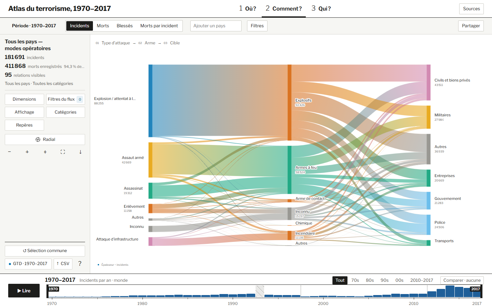

# Des données GTD aux visualisations

La préparation produit plusieurs vues des mêmes incidents. L’unité change selon la question. La carte a besoin de positions, le Sankey de combinaisons de catégories et le classement de valeurs comparables par catégorie et par période.

| Fichier | Transformation | Ce que cela permet de montrer |
| --- | --- | --- |
| [gtd_source.py](gtd_source.py) | Lit les attributs utiles du jeu de données et les convertit vers les types attendus. | Une date, une catégorie et un bilan peuvent être filtrés ou agrégés selon leur rôle. |
| [country_mapping.py](country_mapping.py) et [mapping_pays.csv](mapping_pays.csv) | Rapprochent les libellés de pays de la GTD et les identifiants géographiques. | Un pays sélectionné peut désigner le même territoire dans les différentes planches. |
| [preprocess.py](preprocess.py) | Prépare les séries par année, les regroupements utilisés par les filtres, les données d’incidents par pays et les observations du classement. | Le globe passe d’une concentration à une fiche. Le classement peut changer de catégorie et recalculer ses mesures. |
| [prepare_flow.py](prepare_flow.py) | Regroupe les incidents par année et combinaison de catégories, puis conserve les nombres d’incidents, les bilans et le nombre de bilans connus. | Le Sankey peut calculer la largeur d’une liaison pour le nombre d’incidents, les morts ou les blessés enregistrés. |

*À gauche, le total compte les incidents retenus. Au centre, un même incident peut contribuer à une liaison attaque–arme puis à une liaison arme–cible. La somme des largeurs sur tous les axes ne représente donc pas le nombre total d’incidents.*

**Exemple de lecture.** Trois incidents dont les bilans sont 0, 4 et inconnu donnent trois incidents, quatre morts enregistrés et deux morts par incident avec bilan connu. Un incident sans coordonnées peut compter dans les totaux, mais il ne peut pas être placé sur le globe.
