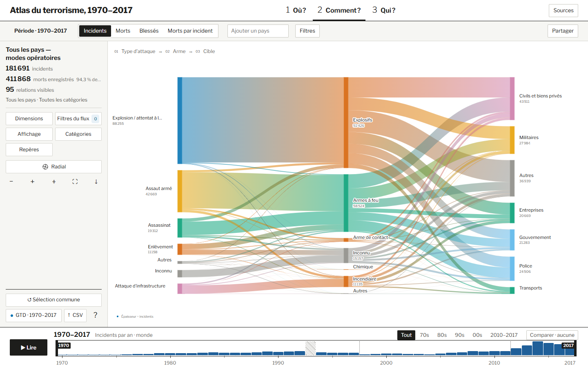

# Comment ? · Diagramme de Sankey

La planche montre **quels attributs apparaissent ensemble** dans les incidents retenus. Les colonnes distinguent les dimensions. La largeur des rubans rend les associations les plus importantes visibles d’un coup d’œil.

*Dans cette capture, la largeur représente le nombre d’incidents. Un lien se lit entre deux colonnes voisines, par exemple « Assaut armé » vers « Armes à feu ».*

## Quel fichier produit chaque élément ?

| Fichier | Responsabilité | Résultat dans la planche |
| --- | --- | --- |
| [index.ts](index.ts) | Charge les données du diagramme et transmet le contexte commun au jeu intégré. | La sélection de pays, la période et les filtres communs peuvent être repris depuis les autres planches. |
| [engine.js](engine.js) | Filtre les incidents agrégés, calcule les poids entre catégories voisines et regroupe les catégories secondaires. | Un ruban épais correspond à une association importante pour la mesure choisie. « Autres » rassemble plusieurs catégories. |
| [geometry.js](geometry.js) | Calcule la disposition des nœuds et des rubans, avec des présentations linéaire et radiale. | La même relation conserve son poids quand la présentation change. |
| [renderer.js](renderer.js) et [template.html](template.html) | Présentent le diagramme, les réglages, les infobulles et les comparaisons. | Le lecteur peut choisir les dimensions, isoler une catégorie et relever le nombre ou la part d’une liaison. |
| [layout.css](layout.css) | Organise les commandes dans la colonne latérale et réserve la surface principale au diagramme. | Les réglages restent accessibles pendant la lecture des rubans. |

**Comment vérifier le choix visuel.** Suivre « Assaut armé » jusqu’à « Armes à feu », puis filtrer sur « Assaut armé » avant d’examiner les cibles à droite. Sans ce filtre, les liaisons qui quittent « Armes à feu » regroupent aussi les incidents des autres types d’attaque. Pour comparer deux périodes, relever dans l’infobulle la valeur et la part de la liaison dans chacune.
