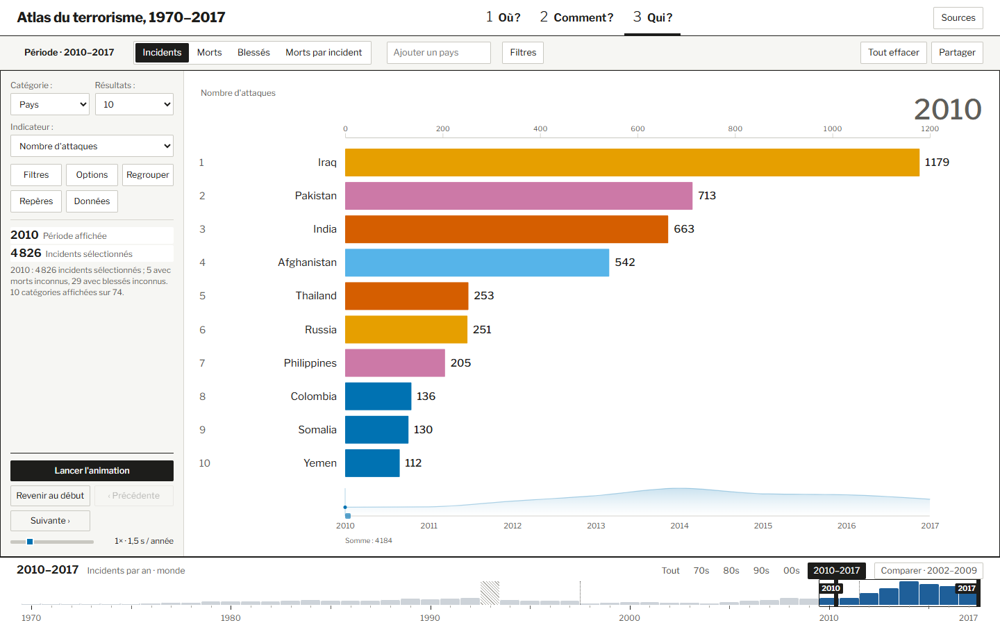

# Qui ? · Bar chart race

Le **bar chart race** montre **qui occupe les premiers rangs** et comment l’ordre évolue. La longueur depuis zéro représente la valeur, l’ordre vertical donne le rang et le libellé identifie la catégorie.

*En 2010, l’Irak apparaît au premier rang avec 1 179 attaques, devant le Pakistan avec 713. La fenêtre 2010–2017 délimite les années de lecture. Les barres visibles correspondent à l’année affichée en haut du graphique.*

## Quel fichier produit chaque élément ?

| Fichier | Responsabilité | Résultat dans la planche |
| --- | --- | --- |
| [index.ts](index.ts) et [shared-countries.ts](shared-countries.ts) | Relient les choix du lecteur au classement et reprennent la sélection de pays du contexte commun. | Le lecteur peut changer de catégorie, de mesure et de périmètre sans quitter la planche. |
| [data/rankings.ts](data/rankings.ts) | Filtre, regroupe et trie les incidents selon la dimension et la mesure. | Les valeurs affichées correspondent à la question choisie, par exemple « quels pays ont enregistré le plus d’attaques ? ». |
| [data/timeline.ts](data/timeline.ts) | Prépare les classements successifs pour la période et le regroupement temporel choisis. | Le lecteur peut passer d’une année ou d’une fenêtre à la suivante. |
| [charts/leaderboard.ts](charts/leaderboard.ts) | Trace l’axe, les barres, les rangs et les valeurs, puis affiche les transitions. | La position verticale change quand une catégorie en dépasse une autre. Le nombre reste lisible en bout de barre. |
| [animation/player.ts](animation/player.ts) et [animation/value-ranking.ts](animation/value-ranking.ts) | Pilotent la lecture et calculent les états intermédiaires des valeurs et des positions. | L’animation aide à suivre une catégorie lorsqu’elle monte, descend ou sort du classement affiché. |
| [data/timeline-summary.ts](data/timeline-summary.ts) et [charts/timeline-summary.ts](charts/timeline-summary.ts) | Préparent et dessinent la synthèse temporelle sous les barres. | La courbe sert de repère pour revenir à une année et contrôler le classement à l’arrêt. |

**Comment vérifier le choix visuel.** Mettre le classement en pause sur deux années, puis relever le rang **et** la valeur du même pays. L’axe peut changer d’échelle et le rang dépend des autres pays. Le nombre affiché permet de savoir si la valeur a monté ou baissé.
