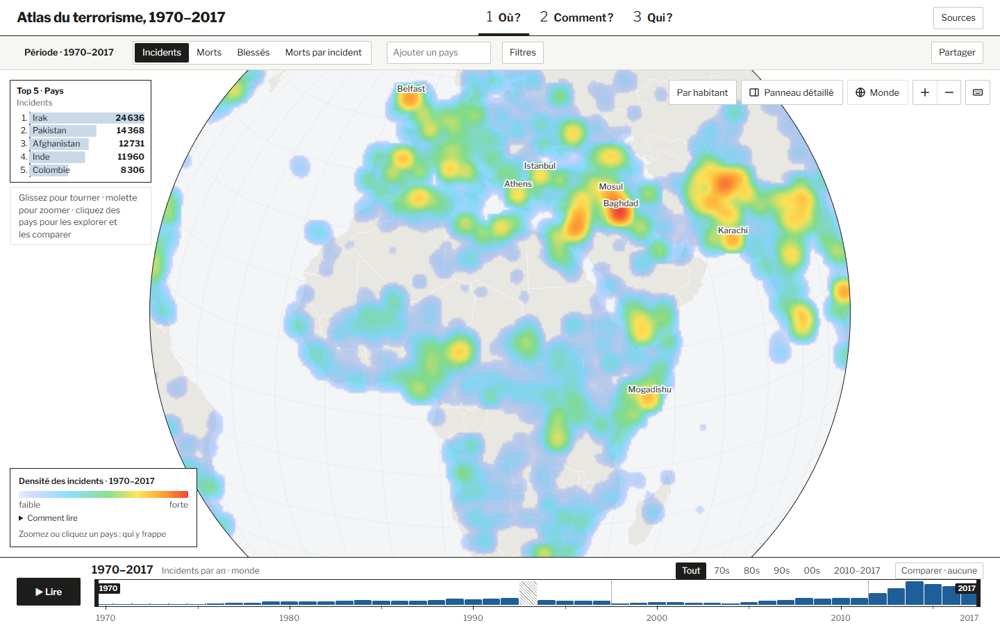
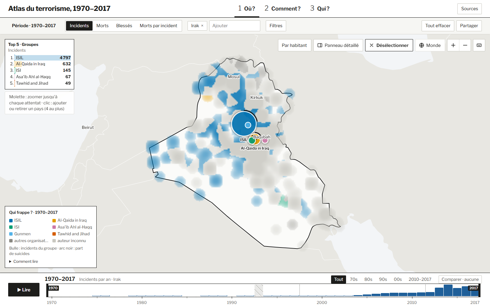

# Où ? · Globe, top 5 et détail des incidents

La carte sert à **localiser une concentration**, puis à comprendre ce qu’elle représente. Le globe garde le territoire comme repère pendant que l’utilisateur change de période, sélectionne un pays ou descend jusqu’à un incident.

*À l’échelle mondiale, la position situe les concentrations. L’encart donne les totaux par pays, que l’intensité de la carte seule ne permet pas de lire précisément.*

*Après sélection de l’Irak, le top 5 classe les groupes du territoire sélectionné. Le bleu de l’ISIL apparaît dans l’encart, sur le globe et dans la légende.*

## Quel fichier produit chaque élément ?

| Fichier | Responsabilité | Résultat dans la planche |
| --- | --- | --- |
| [index.ts](index.ts) et [map.css](map.css) | Assemblent le globe et le panneau détaillé, puis définissent la place des commandes et des encarts. | Le top 5 reste en haut à gauche, en surimpression. Le panneau détaillé s’ouvre à la demande. |
| [globe.ts](globe.ts) et [camera.ts](camera.ts) | Pilotent le cadrage et le passage entre densité, groupes et incidents individuels selon le zoom et la densité visible. Le globe affiche aussi le top 5. | La sélection d’un pays recentre la carte et remplace le classement mondial par celui des groupes de la sélection. |
| [incidents.ts](incidents.ts) et [heat.ts](heat.ts) | Regroupent les incidents géolocalisés proches et produisent le champ de densité. Le champ catégoriel sépare l’activité des groupes. | Les concentrations s’affichent comme des zones continues, puis la couleur distingue les organisations à une échelle plus locale. |
| [organizations.ts](organizations.ts) | Attribue les couleurs des organisations, les formes liées aux armes et les bulles de groupes. | La légende relie les teintes aux noms. Quand les incidents sont visibles individuellement, la forme du symbole renseigne sur l’arme. |
| [model.ts](model.ts) et [frame.ts](frame.ts) | Appliquent les filtres et calculent les valeurs, les rangs et les comparaisons de périodes utilisés par la planche. | Le top 5 et le panneau suivent la période, la mesure et la sélection. |
| [selection.ts](selection.ts) et [panel.ts](panel.ts) | Gèrent les pays sélectionnés et organisent leur détail, des chiffres comparatifs jusqu’à la fiche d’un événement. | Un lecteur peut garder jusqu’à quatre pays dans la comparaison, puis ouvrir une fiche au niveau incident. |

**Comment vérifier le choix visuel.** Repérer une concentration en vue mondiale, sélectionner l’Irak puis comparer la légende et l’encart. Le globe montre l’organisation qui ressort localement, tandis que l’encart la classe sur toute la sélection. Un groupe peut dominer dans une zone sans être premier dans le classement national.
