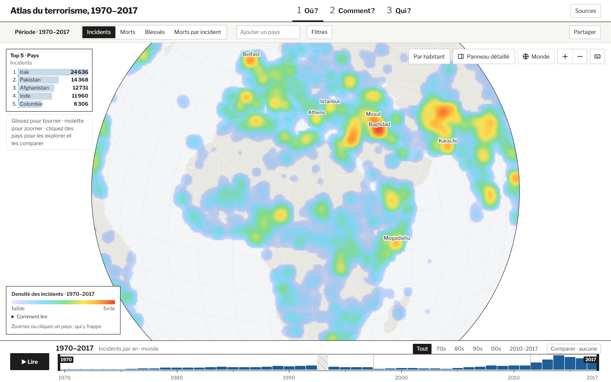

# Les commandes communes aux trois planches

La barre du haut fixe **ce que l’on regarde**. La frise du bas fixe **quand on le regarde**. Leur emplacement reste stable quand on passe du globe au diagramme de flux ou au classement.

*En haut, la mesure, les pays et les filtres définissent le périmètre. En bas, les barres annuelles donnent une vue d’ensemble et la fenêtre sélectionne la période à examiner.*

## Quel fichier produit chaque élément ?

| Fichier | Responsabilité | Résultat dans l’interface |
| --- | --- | --- |
| [main.ts](main.ts) et [planches.ts](planches.ts) | Organisent la navigation entre les trois questions et montent la planche choisie. | « Où ? », « Comment ? » et « Qui ? » restent au même endroit dans la navigation. |
| [context.ts](context.ts) | Présente et met à jour la mesure, les pays sélectionnés et les filtres. | La sélection est visible sous forme de libellés. Le bouton de partage permet de retrouver le contexte affiché. |
| [timeline.ts](timeline.ts) | Affiche la frise, la fenêtre temporelle, les périodes prédéfinies et la commande de comparaison. | Le lecteur peut passer de la série annuelle à une période choisie, puis sélectionner une période de référence. |
| [series.ts](series.ts) | Calcule la série annuelle qui correspond aux pays, aux filtres et à la mesure. | La frise décrit le périmètre exploré. Une année absente, comme 1993, se distingue d’une année à zéro incident. |

**Comment vérifier le choix visuel.** Sélectionner un pays et une période sur le globe, puis passer à **Comment ?**. La même sélection permet d’examiner les modes opératoires de ce périmètre avec le jeu de données intégré. **Qui ?** utilise sa propre lecture du classement à l’intérieur de la période choisie.
